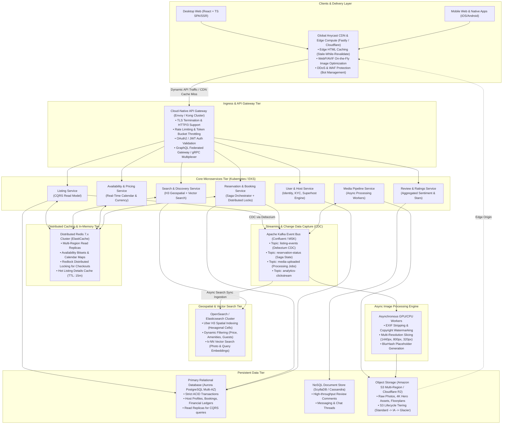
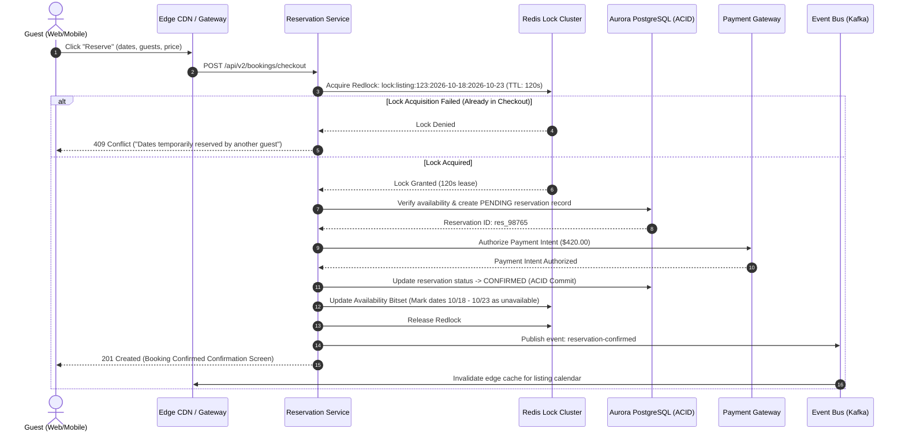

# Production-Scale Architecture Diagram: Vacation-Rental Marketplace

> **System Blueprint & Scaling Strategy**  
> Designed for high-concurrency, low-latency vacation rental platforms (e.g., Airbnb scale: 100M+ listings, 50,000+ QPS search load, sub-50ms p95 latency, 99.99% availability).

---

## 1. High-Level System Architecture Diagram



---

## 2. Comprehensive Scaling Strategy

### 2.1 Frontend Scaling & Edge Architecture

1. **Edge-Rendered Hybrid Delivery**:
   - **Static Asset Caching**: Build bundles, icons, and fonts are distributed with immutable hash names (`/assets/[name]-[hash].js`) and cached at CDN edge nodes with `Cache-Control: public, max-age=31536000, immutable`.
   - **Stale-While-Revalidate HTML**: Listing shell HTML is cached at the edge for 60 seconds with `stale-while-revalidate=86400`. First-byte time (TTFB) is $< 25\text{ms}$ globally.
   - **Micro-Frontend Modular Boundaries**:
     - *Listing Viewer* (this React application: Hero grid, Photo Tour, Lightbox, Overview).
     - *Search & Explore* (interactive map, filter drawer, pagination).
     - *Booking & Payment Flow* (checkout, date validation, payment gateway sandbox).
   - **Dynamic Responsive Media Delivery**:
     - Uses CDN-level image transformation (e.g. Cloudflare Images / Fastly Image Optimizer) to auto-detect client `Accept` headers, serving next-generation formats (`AVIF`, `WebP`) sized to the user's DPR and viewport.
     - Eliminates layout shift (CLS) via explicit CSS aspect ratios (`aspect-ratio: 1120 / 590` on Hero grid, `aspect-ratio: 4 / 3` in Lightbox).

2. **Client-Side State & Network Resilience**:
   - **Server State**: Managed via TanStack Query / SWR with optimistic updates (e.g., immediate UI toggle for Save to Wishlist before server confirmation).
   - **URL State Isolation**: Deep links survive browser refreshes and tab sharing via query params (`?modal=PHOTO_TOUR_SCROLLABLE&modalItem=9`), supported by SPA fallback rewrites.

---

### 2.2 API Gateway & Backend Microservices

1. **Envoy-Based API Gateway**:
   - Terminates client TLS (HTTP/2 and HTTP/3 QUIC).
   - Enforces per-IP and per-account distributed rate limiting using Redis token buckets (preventing scraper attacks on listing prices and calendar dates).
   - Performs distributed authentication via ed25519 asymmetric JWT validation without querying the auth database on every request.

2. **Domain-Driven Microservices**:
   - **Listing Service (CQRS)**:
     - *Write Path*: Host edits and publishes listings $\rightarrow$ validated and written to Aurora PostgreSQL $\rightarrow$ CDC event published to Kafka.
     - *Read Path*: Pre-materialized JSON read-models served directly from local Redis caches in $< 5\text{ms}$.
   - **Availability & Pricing Engine**:
     - Uses 365-day integer bitsets representing daily reservation availability (where `0` = available, `1` = reserved). Bitwise `AND`/`OR` operations allow sub-millisecond range checking for 5-night bookings across thousands of listings simultaneously.
   - **Reservation & Booking Service (Saga Pattern)**:
     - Solves the critical vacation-rental challenge: **strict prevention of double-booking under concurrent checkouts**.
     - Implements distributed lease locks using Redis Redlock (e.g., a 120-second exclusive hold on `listing_id + dates`).
     - Coordinates payment intent with Stripe/Adyen, updates reservation ledger in Aurora with serializable isolation, and emits `reservation-confirmed` event upon completion.

---

### 2.3 Storage & Caching Tier Strategy

| Tier | Technology | Purpose | Scaling Mechanism |
| :--- | :--- | :--- | :--- |
| **L1 Browser Cache** | Service Worker / HTTP Cache | Static JS/CSS assets, WebP images, fonts | Immutable hashing (`max-age=1y`) |
| **L2 Edge CDN** | Cloudflare / Fastly | Page HTML, responsive image transforms, GraphQL read cache | 300+ Edge PoPs with Stale-While-Revalidate |
| **L3 Distributed Cache** | Redis 7.x Cluster | Listing objects, availability bitsets, booking locks | Sharded cluster (32 nodes), multi-AZ read replicas |
| **ACID Master DB** | AWS Aurora PostgreSQL | Reservations, host payouts, identity, user credentials | Multi-AZ auto-failover, 15 read replicas, connection pooling (PgBouncer) |
| **Document Store** | ScyllaDB / Cassandra | Reviews, user messages, audit logs, clickstream events | Masterless peer-to-peer ring topology, wide-column keying |
| **Blob Storage** | Cloudflare R2 / AWS S3 | Multi-resolution photos, host identity documents | S3 Intelligent-Tiering, multi-region replication |

---

### 2.4 Search & Geospatial Discovery Engine

1. **Uber H3 Hexagonal Spatial Indexing**:
   - The globe is partitioned into hierarchical hexagonal cells (H3 Resolution 7 $\approx 1.2\text{km}$ edge length).
   - Each listing is assigned an H3 index. Bounding-box map viewport queries convert viewport polygons to a set of H3 hexagons, querying Elasticsearch by indexed terms rather than performing computationally expensive geometric polygon intersections.
   - Result: Sub-15ms search latency across 50,000 concurrent map pan/zoom operations.

2. **Dual-Write Prevention (Change Data Capture)**:
   - Primary data mutations occur strictly in Aurora PostgreSQL.
   - Debezium monitors the PostgreSQL Write-Ahead Log (WAL) and streams changes to Kafka topics.
   - OpenSearch consumers ingest Kafka events and update search indexes asynchronously within 500ms, completely avoiding dual-write divergence bugs.

---

### 2.5 Global Multi-Region Deployment Strategy

```text
                           [ Global Route 53 / Cloudflare DNS (Latency-Based Routing) ]
                                      /                                \
                 ====================/==================================\====================
                |                                                                            |
       [ US-East Primary Region (us-east-1) ]                       [ EU-West Secondary Region (eu-west-1) ]
       +------------------------------------+                       +------------------------------------+
       | • EKS Kubernetes Cluster           |                       | • EKS Kubernetes Cluster           |
       |   - Karpenter Dynamic Autoscaling  |                       |   - Karpenter Dynamic Autoscaling  |
       |   - Envoy API Gateway Ingress      |                       |   - Envoy API Gateway Ingress      |
       | • Aurora PostgreSQL Primary (Write)| <== Aurora Global ===>| • Aurora PostgreSQL Read Replica   |
       | • Redis Cluster (Master / Replica) |    Replication        | • Redis Cluster (Local Replicas)   |
       | • Kafka Cluster (MSK Multi-AZ)     | <== MirrorMaker 2 ===>| • Kafka Cluster (MSK Consumer)     |
       | • OpenSearch Cluster               |                       | • OpenSearch Cluster               |
       +------------------------------------+                       +------------------------------------+
```

1. **Multi-Region Active-Active with Global Read Replicas**:
   - Aurora Global Database ensures cross-region storage replication latency under 1 second.
   - Read traffic (98% of total marketplace requests: browsing listings, searching cities, reading reviews) is serviced entirely within the user's nearest geographic region.
   - Write traffic (booking creation, listing publishing) routes to the active primary region through low-latency backbone interconnects.

2. **GitOps CI/CD & Deployment Safeguards**:
   - **ArgoCD + Kubernetes**: Declarative configuration with Canary releases (progressive traffic shifting: 5% $\rightarrow$ 25% $\rightarrow$ 100%).
   - **Automated Rollback Triggers**: Automated rollback if Prometheus metrics detect p99 latency $> 250\text{ms}$ or HTTP 5xx error rate $> 0.05\%$.
   - **Playwright Visual QA Integration**: Automated visual diff tests run on staging clusters prior to production promotion, verifying zero layout shifts or visual regressions across 1440px/1280px/1920px viewports.

---

## 3. High-Concurrency Booking Flow (Zero Double-Booking Guarantee)



---

## 4. Verification & Submission Deliverables

- **Mermaid Source Diagram**: Embedded in this specification for direct markdown preview.
- **Standalone SVG Architecture Diagram**: Generated at [`docs/architecture-diagram.svg`](file:///c:/Users/hp/Downloads/airbnb_clone/docs/architecture-diagram.svg) and [`public/architecture-diagram.svg`](file:///c:/Users/hp/Downloads/airbnb_clone/public/architecture-diagram.svg) for interactive browser viewing and high-res vector rendering.
- **Excalidraw Native File**: Sourced at [`docs/architecture-diagram.excalidraw`](file:///c:/Users/hp/Downloads/airbnb_clone/docs/architecture-diagram.excalidraw) for direct import into [excalidraw.com](https://excalidraw.com) or Lucidchart.
