# Airbnb Listing Clone — Implementation Plan (Phase 2: Planning)

> **Phase Gate Notice**: This document specifies the complete architectural, structural, and behavioral plan for developing the pixel-perfect, desktop-only Airbnb listing page clone. No application code will be executed until this plan receives formal user approval.

---

## 1. Folder Structure & Component Hierarchy

### 1.1 Directory Tree (Original, Modular Architecture)

The codebase will be initialized using **React 18 + TypeScript (strict mode) + Vite** with **CSS Modules**. In strict compliance with originality rules, all folder names, component names, CSS modules, and custom hooks are designed from first principles:

```text
c:\Users\hp\Downloads\airbnb_clone\
├── docs/
│   ├── originality-log.md           # Observational log and anti-plagiarism compliance
│   ├── reference-spec.md            # Interaction matrix, photo tour, and lightbox specs
│   └── implementation-plan.md       # Architectural blueprint & definition of done
├── screenshots/
│   └── photo-tour/                  # Visual audit references (15 high-res states)
├── public/
│   └── favicon.ico                  # Airbnb branded SVG/ICO
├── src/
│   ├── assets/                      # Static assets and icons
│   ├── components/
│   │   ├── common/                  # Shared UI primitives
│   │   │   ├── Button/
│   │   │   │   ├── Button.tsx
│   │   │   │   └── Button.module.css
│   │   │   ├── Badge/
│   │   │   │   ├── Badge.tsx
│   │   │   │   └── Badge.module.css
│   │   │   ├── Modal/
│   │   │   │   ├── ModalBackdrop.tsx
│   │   │   │   └── ModalBackdrop.module.css
│   │   │   └── Icons/               # Original clean inline SVG icons
│   │   │       ├── AirbnbLogoIcon.tsx
│   │   │       ├── SearchIcon.tsx
│   │   │       ├── GlobeIcon.tsx
│   │   │       ├── MenuBarsIcon.tsx
│   │   │       ├── AvatarIcon.tsx
│   │   │       ├── ShareIcon.tsx
│   │   │       ├── HeartIcon.tsx
│   │   │       ├── GridIcon.tsx
│   │   │       ├── StarIcon.tsx
│   │   │       ├── CloseIcon.tsx
│   │   │       ├── ChevronLeftIcon.tsx
│   │   │       ├── ChevronRightIcon.tsx
│   │   │       ├── ChevronDownIcon.tsx
│   │   │       ├── LaurelWreathIcon.tsx
│   │   │       ├── AmenityIcons.tsx # Kitchen, Wifi, Pool, HotTub, Workspace, etc.
│   │   │       └── RatingIcons.tsx  # SprayBottle, CheckmarkCircle, KeyCircle, etc.
│   │   ├── layout/                  # Page shell and global structural framing
│   │   │   ├── SiteHeader/
│   │   │   │   ├── SiteHeader.tsx
│   │   │   │   └── SiteHeader.module.css
│   │   │   ├── StickyNavHeader/
│   │   │   │   ├── StickyNavHeader.tsx
│   │   │   │   └── StickyNavHeader.module.css
│   │   │   └── SiteFooter/
│   │   │       ├── SiteFooter.tsx
│   │   │       └── SiteFooter.module.css
│   │   ├── listing/                 # Main Listing Page components (View 1)
│   │   │   ├── ListingHeading/
│   │   │   │   ├── ListingHeading.tsx
│   │   │   │   └── ListingHeading.module.css
│   │   │   ├── HeroPhotoGrid/
│   │   │   │   ├── HeroPhotoGrid.tsx
│   │   │   │   └── HeroPhotoGrid.module.css
│   │   │   ├── ListingOverview/
│   │   │   │   ├── ListingOverview.tsx
│   │   │   │   └── ListingOverview.module.css
│   │   │   ├── HighlightsSection/
│   │   │   │   ├── HighlightsSection.tsx
│   │   │   │   └── HighlightsSection.module.css
│   │   │   ├── DescriptionSection/
│   │   │   │   ├── DescriptionSection.tsx
│   │   │   │   └── DescriptionSection.module.css
│   │   │   ├── SleepingArrangements/
│   │   │   │   ├── SleepingArrangements.tsx
│   │   │   │   └── SleepingArrangements.module.css
│   │   │   ├── AmenitiesSection/
│   │   │   │   ├── AmenitiesSection.tsx
│   │   │   │   ├── AmenitiesModal.tsx
│   │   │   │   └── AmenitiesSection.module.css
│   │   │   ├── CalendarSection/
│   │   │   │   ├── CalendarSection.tsx
│   │   │   │   ├── DualMonthCalendar.tsx
│   │   │   │   └── CalendarSection.module.css
│   │   │   ├── ReservationSidebar/
│   │   │   │   ├── ReservationCard.tsx
│   │   │   │   ├── GuestCounterDropdown.tsx
│   │   │   │   └── ReservationCard.module.css
│   │   │   ├── ReviewsSection/
│   │   │   │   ├── ReviewsSection.tsx
│   │   │   │   ├── ReviewCard.tsx
│   │   │   │   ├── RatingDistributionBar.tsx
│   │   │   │   └── ReviewsSection.module.css
│   │   │   ├── LocationSection/
│   │   │   │   ├── LocationSection.tsx
│   │   │   │   └── LocationSection.module.css
│   │   │   ├── HostProfileSection/
│   │   │   │   ├── HostProfileSection.tsx
│   │   │   │   └── HostProfileSection.module.css
│   │   │   └── NearbyStaysCarousel/
│   │   │       ├── NearbyStaysCarousel.tsx
│   │   │       └── NearbyStaysCarousel.module.css
│   │   ├── photoTour/               # Photo Tour Overlay (View 2)
│   │   │   ├── PhotoTourOverlay.tsx
│   │   │   ├── PhotoTourHeader.tsx
│   │   │   ├── CategoryThumbnailBar.tsx
│   │   │   ├── RoomPhotoSection.tsx
│   │   │   ├── RoomPhotoGrid.tsx
│   │   │   └── PhotoTourOverlay.module.css
│   │   └── lightbox/                # Lightbox Single-Photo Viewer (View 3)
│   │       ├── LightboxViewer.tsx
│   │       ├── LightboxHeader.tsx
│   │       ├── LightboxControls.tsx
│   │       └── LightboxViewer.module.css
│   ├── data/                        # Isolated, typed local mock database
│   │   ├── listingData.ts
│   │   └── types.ts
│   ├── hooks/                       # Custom accessibility and interaction hooks
│   │   ├── useUrlModalState.ts      # URL query/hash modal synchronized state
│   │   ├── useScrollLock.ts         # Zero-layout-shift body scroll freeze
│   │   ├── useFocusTrap.ts          # Accessible keyboard tab-cycling trap
│   │   ├── useFocusReturn.ts        # Restores focus to trigger upon dismissal
│   │   ├── useScrollSpy.ts          # Tracks active section for sticky sub-nav
│   │   └── useStickyTrigger.ts      # Measures scrollY boundaries for header & card
│   ├── styles/                      # Global tokens and resets
│   │   ├── tokens.css               # CSS custom properties (colors, radii, shadows)
│   │   ├── reset.css                # Box-sizing, margin resets, typography setup
│   │   └── global.css               # High-contrast focus rings, root typography
│   ├── App.tsx                      # Root component orchestrating the 3 views
│   ├── main.tsx                     # Vite React entry point
│   └── vite-env.d.ts
├── index.html                       # Desktop meta, SEO, Inter font stylesheet
├── vercel.json                      # Production SPA rewrite rule
├── vite.config.ts                   # Sourcemap disabled, CSS modules config
├── tsconfig.json                    # Strict TypeScript configuration
├── package.json
├── AGENTS.md                        # Master governing guidelines
├── PROMPTS.md                       # Comprehensive prompt audit log
└── README.md
```

### 1.2 Component Tree & Data Flow

```mermaid
graph TD
    App["App (Root)"] --> SiteHeader["SiteHeader (Logo, Search Pill, Menu)"]
    App --> ListingHeading["ListingHeading (Title, Share, Saved)"]
    App --> HeroPhotoGrid["HeroPhotoGrid (5-Photo Bento, Show All Photos Button)"]
    App --> StickyNavHeader["StickyNavHeader (scrollY > 560px: Photos, Amenities, Reviews, Location)"]
    
    App --> MainContentGrid["Main Content 2-Column Grid"]
    MainContentGrid --> LeftColumn["Left Column (~65% width)"]
    MainContentGrid --> RightColumn["Right Column (~35% width, Sticky Container)"]
    
    LeftColumn --> ListingOverview["ListingOverview (Entire serviced apt, Bed/Bath summary)"]
    LeftColumn --> HighlightsSection["HighlightsSection (Outdoor, AC, Self check-in)"]
    LeftColumn --> DescriptionSection["DescriptionSection (Text with 'Show more >')"]
    LeftColumn --> SleepingArrangements["SleepingArrangements (Bedroom & Living room cards)"]
    LeftColumn --> AmenitiesSection["AmenitiesSection (10 visible amenities, 'Show all 50 amenities')"]
    LeftColumn --> CalendarSection["CalendarSection (Dual-month inline calendar, date picker)"]
    
    RightColumn --> ReservationSidebar["ReservationCard (Sticky 560px-2400px: Pricing, Dates, Guests Dropdown, Reserve)"]
    
    App --> ReviewsSection["ReviewsSection (Guest Favourite badge, Rating bars, Reviews list)"]
    App --> LocationSection["LocationSection (Map view, neighborhood description)"]
    App --> HostProfileSection["HostProfileSection (Host badge, co-hosts, details)"]
    App --> NearbyStaysCarousel["NearbyStaysCarousel (1/2 slider of nearby listings)"]
    App --> SiteFooter["SiteFooter (Airbnb policies, language, currency)"]
    
    App -.->|URL: ?modal=PHOTO_TOUR_SCROLLABLE| PhotoTourOverlay["PhotoTourOverlay (View 2: 9 room sections, category thumbnail strip)"]
    PhotoTourOverlay -.->|URL: &modalItem=ID| LightboxViewer["LightboxViewer (View 3: Prev/Next arrows, 1 of 43 counter, keyboard nav)"]
```



---

## 2. Design Tokens (`src/styles/tokens.css`)

Derived directly from the computed values documented in `docs/reference-spec.md`:

```css
:root {
  /* Color Palette */
  --color-primary: #FF385C;
  --color-primary-dark: #E00B41;
  --color-primary-gradient: linear-gradient(to right, #E61E4D 0%, #E31C5F 50%, #D70466 100%);
  --color-primary-gradient-hover: linear-gradient(to right, #D70466 0%, #BD0352 100%);
  
  --color-text-dark: #222222;
  --color-text-muted: #717171;
  --color-text-subtle: #6A6A6A;
  --color-text-light: #FFFFFF;
  
  --color-surface-white: #FFFFFF;
  --color-surface-light: #F7F7F7;
  --color-surface-hover: #F0F0F0;
  --color-surface-active: #EBEBEB;
  
  --color-border-light: #DDDDDD;
  --color-border-subtle: #EBEBEB;
  --color-border-medium: #B0B0B0;
  --color-border-dark: #222222;
  
  /* Typography */
  --font-family-base: -apple-system, BlinkMacSystemFont, "Segoe UI", Roboto, Helvetica, Arial, sans-serif;
  --font-size-xs: 12px;
  --font-size-sm: 14px;
  --font-size-base: 16px;
  --font-size-lg: 18px;
  --font-size-xl: 22px;
  --font-size-2xl: 26px;
  --font-size-hero: 32px;
  --font-size-rating-badge: 84px;
  
  --font-weight-regular: 400;
  --font-weight-medium: 500;
  --font-weight-semibold: 600;
  --font-weight-bold: 700;
  
  /* Spacing Scale */
  --space-2: 2px;
  --space-4: 4px;
  --space-6: 6px;
  --space-8: 8px;
  --space-12: 12px;
  --space-16: 16px;
  --space-20: 20px;
  --space-24: 24px;
  --space-32: 32px;
  --space-40: 40px;
  --space-48: 48px;
  --space-64: 64px;
  --space-80: 80px;
  
  /* Corner Radii */
  --radius-xs: 4px;
  --radius-sm: 8px;
  --radius-md: 12px;
  --radius-lg: 16px;
  --radius-xl: 24px;
  --radius-pill: 9999px;
  
  /* Elevation & Shadows */
  --shadow-sm: 0 1px 2px rgba(0, 0, 0, 0.08);
  --shadow-md: 0 2px 4px rgba(0, 0, 0, 0.12);
  --shadow-card: 0 6px 16px rgba(0, 0, 0, 0.12);
  --shadow-floating: 0 8px 28px rgba(0, 0, 0, 0.15);
  --shadow-modal: 0 8px 40px rgba(0, 0, 0, 0.28);
  --shadow-button-hover: 0 4px 12px rgba(227, 28, 95, 0.35);
  
  /* Transition Timing & Easing */
  --transition-fast: 150ms ease;
  --transition-base: 200ms ease;
  --transition-smooth: 250ms cubic-bezier(0.2, 0, 0, 1);
  --transition-modal: 300ms cubic-bezier(0.2, 0, 0, 1);
  --transition-bounce: 200ms cubic-bezier(0.175, 0.885, 0.32, 1.275);
  
  /* Layout Dimensions */
  --max-content-width: 1120px;
  --header-height: 80px;
  --sticky-nav-height: 48px;
  --reservation-card-width: 372px;
  --sticky-top-offset: 80px;
}
```

---

## 3. Data Model (`src/data/types.ts`)

A strongly typed schema isolating all listing data, room categories, public photos, amenities, host records, and reviews:

```typescript
export interface ListingPhoto {
  id: string;
  category: RoomCategory;
  url: string;
  alt: string;
  caption?: string;
  isHero?: boolean;
  heroPosition?: 'main' | 'top-middle' | 'top-right' | 'bottom-middle' | 'bottom-right';
}

export type RoomCategory = 
  | 'living-room-1'
  | 'living-room-2'
  | 'kitchen'
  | 'bedroom'
  | 'bathroom'
  | 'gym'
  | 'exterior'
  | 'pool'
  | 'additional';

export interface RoomSection {
  id: RoomCategory;
  title: string;
  subtitle?: string;
  thumbnailUrl: string;
  photos: ListingPhoto[];
}

export interface AmenityItem {
  id: string;
  label: string;
  category: 'Bathroom' | 'Bedroom and laundry' | 'Entertainment' | 'Heating and cooling' | 'Home safety' | 'Internet and office' | 'Kitchen and dining' | 'Location features' | 'Outdoor' | 'Parking and facilities' | 'Services';
  iconName: string;
  isPopular?: boolean;
  isStrikethrough?: boolean;
}

export interface ReviewItem {
  id: string;
  authorName: string;
  authorAvatarUrl?: string;
  authorDuration: string;
  rating: number;
  date: string;
  comment: string;
}

export interface RatingCategoryScores {
  cleanliness: number;
  accuracy: number;
  checkIn: number;
  communication: number;
  location: number;
  value: number;
}

export interface HostProfile {
  name: string;
  avatarUrl: string;
  isVerified: boolean;
  reviewsCount: number;
  rating: number;
  hostingYears: number;
  responseRate: string;
  responseTime: string;
  coHosts: Array<{ name: string; avatarUrl: string }>;
}

export interface ReservationPricing {
  nightlyRate: number;
  defaultNights: number;
  cleaningFee: number;
  serviceFee: number;
  discountPercent?: number;
}

export interface ListingDetails {
  id: string;
  title: string;
  location: string;
  propertyType: string;
  guestCapacity: number;
  bedroomsCount: number;
  bedsCount: number;
  bathroomsCount: number;
  overallRating: number;
  totalReviews: number;
  isGuestFavourite: boolean;
  description: string[];
  pricing: ReservationPricing;
  ratings: RatingCategoryScores;
  host: HostProfile;
  amenities: AmenityItem[];
  reviews: ReviewItem[];
  roomSections: RoomSection[];
  allPhotos: ListingPhoto[];
}
```

---

## 4. Overlay State Strategy (URL-Driven Routing)

To ensure that browser **Back** and **Forward** buttons operate naturally, and to allow direct deep-linking into both the Photo Tour and Lightbox views, modal state is driven strictly via URL query parameters and HTML5 `history.pushState`:

```text
Listing Page (Base URL):
https://domain.com/

Photo Tour Overlay (View 2):
https://domain.com/?modal=PHOTO_TOUR_SCROLLABLE

Lightbox Single-Photo Viewer (View 3):
https://domain.com/?modal=PHOTO_TOUR_SCROLLABLE&modalItem=1000
```

### State Transition Flow
```mermaid
stateDiagram-v2
    [*] --> ListingPage: Page Load (URL: /)
    
    ListingPage --> PhotoTour: Click "Show all photos" or Hero Image
    note right of PhotoTour: URL: ?modal=PHOTO_TOUR_SCROLLABLE\nBody scroll locked\nFocus -> Back (<) button
    
    PhotoTour --> ListingPage: Click Back (<) or Press Escape or Browser Back
    note left of ListingPage: URL: /\nBody scroll unlocked\nFocus returned to trigger
    
    PhotoTour --> Lightbox: Click Photo Card
    note right of Lightbox: URL: ?modal=PHOTO_TOUR_SCROLLABLE&modalItem=ID\nFocus -> Close (X) button
    
    Lightbox --> PhotoTour: Click Close (X) or Grid Icon or Press Escape or Browser Back
    note left of PhotoTour: URL: ?modal=PHOTO_TOUR_SCROLLABLE\nFocus returned to clicked photo card
    
    Lightbox --> ListingPage: Direct navigation / Deep link closed
```

- **SPA Rewrite Rule (`vercel.json`)**:
  ```json
  {
    "rewrites": [
      { "source": "/(.*)", "destination": "/index.html" }
    ]
  }
  ```
  Ensures that refreshing while in `?modal=PHOTO_TOUR_SCROLLABLE&modalItem=1000` re-hydrates the application into the exact modal state without 404 errors.

---

## 5. Animation Approach & Reduced-Motion Safeguards

All animations utilize hardware-accelerated CSS properties (`transform`, `opacity`) to guarantee 60fps rendering without triggering browser reflows:

1. **Photo Tour Overlay**:
   - `transition: transform 250ms cubic-bezier(0.2, 0, 0, 1), opacity 250ms ease;`
   - Slide-up (`translateY(100%)` $\rightarrow$ `translateY(0)`).
2. **Lightbox Viewer**:
   - `transition: transform 200ms cubic-bezier(0.2, 0, 0, 1), opacity 200ms ease;`
   - Subtle zoom-in (`scale(0.96)` $\rightarrow$ `scale(1.0)`).
3. **Sticky Sub-Navigation Bar**:
   - `transition: transform 250ms ease-out;`
   - Slides down smoothly when scrolling past `scrollY > 560px`.
4. **`prefers-reduced-motion` Media Query**:
   ```css
   @media (prefers-reduced-motion: reduce) {
     *, *::before, *::after {
       animation-duration: 0.01ms !important;
       animation-iteration-count: 1 !important;
       transition-duration: 0.01ms !important;
       scroll-behavior: auto !important;
     }
   }
   ```

---

## 6. Accessibility Engineering Plan

1. **`useFocusTrap(active: boolean, containerRef: RefObject<HTMLElement>)`**:
   - Traps keyboard `Tab` and `Shift+Tab` within the topmost modal dialog (`PhotoTourOverlay` or `LightboxViewer`).
   - Automatically detects all focusable nodes (`button, [href], input, select, textarea, [tabindex]:not([tabindex="-1"])`).
2. **`useFocusReturn()`**:
   - Captures `document.activeElement` prior to opening an overlay and restores focus precisely upon dismissal.
3. **`useScrollLock(locked: boolean)`**:
   - Applies `overflow: hidden;` to `<html>` and `<body>`.
   - Computes scrollbar width (`window.innerWidth - document.documentElement.clientWidth`) and adds corresponding `padding-right` to prevent horizontal layout jank.
4. **Visible Focus Rings**:
   - High-contrast `:focus-visible` styling (`outline: 2px solid #222222; outline-offset: 2px;`).
   - Suppressed on mouse clicks via `:focus:not(:focus-visible)`.
5. **Screen Reader Live Regions**:
   - An `aria-live="polite"` node announces Lightbox navigation: `"Photo X of 43: [Room Title]"`.
   - Guest counters announce updated quantities on stepper clicks.

---

## 7. Performance & Optimization Strategy

1. **Zero-CLS Layout Reservation**:
   - All image containers explicitly declare aspect ratios (e.g., `aspect-ratio: 3 / 2` or `aspect-ratio: 16 / 9`) and skeleton placeholder backgrounds (`#EBEBEB`) to prevent Cumulative Layout Shift during loading.
2. **Image Loading Strategy**:
   - **Hero Images (5 photos)**: `loading="eager"` with `fetchpriority="high"`.
   - **Photo Tour / Lower Sections**: Native `loading="lazy"` with `decoding="async"`.
3. **Adjacent Image Preloading in Lightbox**:
   - When viewing photo index $i$, an invisible background link or image object preloads $i - 1$ and $i + 1$:
     ```typescript
     useEffect(() => {
       if (isOpen && currentPhotoIndex !== null) {
         const nextPhoto = allPhotos[currentPhotoIndex + 1];
         const prevPhoto = allPhotos[currentPhotoIndex - 1];
         if (nextPhoto) new Image().src = nextPhoto.url;
         if (prevPhoto) new Image().src = prevPhoto.url;
       }
     }, [currentPhotoIndex, isOpen]);
     ```

---

## 8. Build Order & Definition of Done

Development will proceed in strict, incremental phases with atomic Git commits:

### Phase 3.1: Foundation & Project Setup
- [ ] Initialize Vite + React + TypeScript in `./`.
- [ ] Install dev dependencies (`clsx` or standalone utility).
- [ ] Configure `vite.config.ts` (`build.sourcemap: false`) and `vercel.json` (SPA rewrite).
- [ ] Set up `src/styles/tokens.css`, `reset.css`, `global.css`.
- [ ] Author `src/data/listingData.ts` with all 43 high-res photo URLs, room categories, amenities, host details, and reviews.
- [ ] Build shared inline SVG icon library in `src/components/common/Icons/`.

### Phase 3.2: View 1 — Main Listing Page
- [ ] **Header**: Airbnb logo, search pill with magnifier, host menu.
- [ ] **Hero Grid**: 5-image bento layout, hover dimming (`brightness(0.92)`), "Show all photos" button with tactile press.
- [ ] **Sticky Sub-Nav**: Scroll-triggered header appearing at `scrollY > 560px` with active tab tracking and smooth-scroll.
- [ ] **Listing Body**: Title, Guest Favourite badge, Host summary, Highlights, Clamped description with "Show more", Sleeping arrangements cards.
- [ ] **Amenities**: 10 primary amenities with custom icons, "Show all 50 amenities" button opening categorized modal.
- [ ] **Inline Calendar**: Dual-month side-by-side calendar with date range selection and "Clear dates".
- [ ] **Sticky Reservation Card**: Pinned at `top: 80px` from `scrollY: 560px` to `2400px`, dynamic date/pricing calculation, interactive guest selector dropdown.
- [ ] **Reviews & Location**: Rating category bars, reviews grid, Candolim map view, Host profile, Nearby stays slider, and Footer.

### Phase 3.3: View 2 — Photo Tour Overlay
- [ ] Fullscreen slide-up modal with body scroll lock.
- [ ] Sticky header with back button (`<`), title, share, save.
- [ ] 9-thumbnail category strip with smooth scroll navigation and active section tracking.
- [ ] Two-column stream: sticky room descriptions on left, photo grids on right.
- [ ] Deep linking: clicking hero images 0-4 opens Photo Tour scrolled to corresponding section.
- [ ] Full keyboard navigation (`Escape` dismiss, focus trap, focus return).

### Phase 3.4: View 3 — Lightbox Single-Photo Viewer
- [ ] Zoom-and-fade modal opened from any Photo Tour image.
- [ ] Contained image display (`max-width: calc(100vw - 160px)`, `max-height: calc(100vh - 160px)`).
- [ ] Previous and Next circular arrow controls (disabled at Photo 1 and Photo 43).
- [ ] Photo counter (`X of 43`), category title, 9-dot grid button returning to Photo Tour.
- [ ] Keyboard navigation: `ArrowLeft`, `ArrowRight`, `Escape`.
- [ ] URL-driven routing (`?modal=PHOTO_TOUR_SCROLLABLE&modalItem=ID`) enabling browser Back/Forward navigation.

### Phase 4: Design QA & Multi-Viewport Verification
- [ ] Pixel verification at **1440px** primary viewport.
- [ ] Responsive check at **1280px** and **1920px**.
- [ ] Cross-browser test (Chrome, Edge).
- [ ] Accessibility audit: Lighthouse score $\ge 95$, zero focus traps leaks, full keyboard operability.

---

### Request for User Approval

This implementation plan defines the complete architecture, data models, state management, and build sequence. **Please approve this plan to authorize beginning Phase 3 (Build).**
