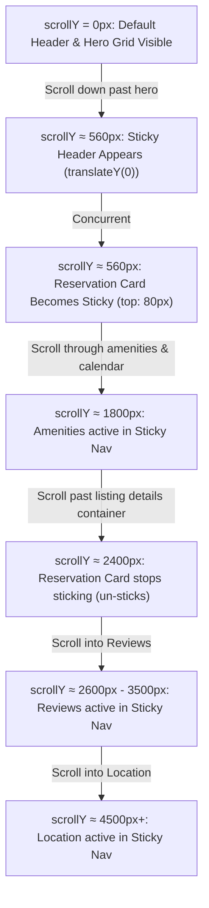

# Airbnb Listing Clone — Reference Specification

## Interaction Matrix

This document provides the exhaustive interaction specification for the desktop-only Airbnb listing page clone, based strictly on rendered visual observation and computed style measurements of the reference application (`https://airbnb-clone-umber-two.vercel.app`) at target viewport **1440px** (with validation at **1280px** and **1920px**).

---

### 1. Interaction Matrix Table

| Element | Trigger | Effect | Duration | Easing | Notes |
| :--- | :--- | :--- | :--- | :--- | :--- |
| **Airbnb Logo** | Hover | Cursor: `pointer`; opacity shifts from `1.0` to `0.85` | 150ms | `ease` | Navigates to home/listing top; retains brand red (`#FF385C`). |
| **Airbnb Logo** | Active (Click) | Scale: `scale(0.96)` momentary compression | 100ms | `ease-out` | Smooth return to top of listing. |
| **Search Bar Pill Container** | Hover | Shadow elevation: `0 1px 2px rgba(0,0,0,0.08)` $\rightarrow$ `0 4px 12px rgba(0,0,0,0.12)`; border stays `#DDDDDD` | 200ms | `ease` | Centered top header element; cursor: `pointer`. |
| **Search Bar Pill Container** | Active (Click) | Border highlight `#222222` or expands search dropdown | 200ms | `ease-in-out` | Triggers search overlay or focuses search fields. |
| **Search Icon Button** (Red Circle) | Hover | Background color: `#FF385C` $\rightarrow$ `#E00B41`; scale `scale(1.04)` | 150ms | `ease` | Contained inside search pill; white search magnifier SVG. |
| **Search Icon Button** | Active (Click) | Scale: `scale(0.94)` | 100ms | `ease-out` | Initiates search query action. |
| **"Become a host" Button** | Hover | Background: `transparent` $\rightarrow$ `#F7F7F7`; border-radius `22px`; cursor: `pointer` | 200ms | `ease` | Text color stays `#222222`; font-size: `14px`, `font-weight: 500`. |
| **Globe (Language) Button** | Hover | Background: `transparent` $\rightarrow$ `#F7F7F7`; border-radius `50%`; cursor: `pointer` | 200ms | `ease` | Circular button containing inline SVG globe. |
| **User Profile Menu Pill** | Hover | Shadow elevation: `0 1px 2px rgba(0,0,0,0.08)` $\rightarrow$ `0 2px 4px rgba(0,0,0,0.18)` | 200ms | `ease` | Pill containing hamburger (3 lines) and user avatar SVG. |
| **User Profile Menu Pill** | Active (Click) | Toggles floating menu popup (Log in, Sign up, Help) | 150ms | `ease` | Closes when clicking outside (backdrop dismiss). |
| **Listing Title Action: "Share"** | Hover | Text underline appears; background: `transparent` $\rightarrow$ `#F7F7F7`; border-radius `8px`; cursor: `pointer` | 150ms | `ease` | Contains share/upload icon + text "Share". |
| **Listing Title Action: "Share"** | Active (Click) | Opens Share modal / copies listing URL to clipboard with confirmation | 200ms | `ease-out` | Focus is trapped inside modal when open. |
| **Listing Title Action: "Saved"** | Hover | Text underline appears; scale `scale(1.04)`; cursor: `pointer` | 150ms | `ease` | Heart icon on left. |
| **Listing Title Action: "Saved"** | Active (Click) | Heart icon fills vibrant red (`#FF385C`); toggles wishlist state between Saved and Unsaved | 200ms | `cubic-bezier(0.175, 0.885, 0.32, 1.275)` | Subtle pop/bounce animation on click. |
| **Promo Banner "Claim" Button** | Hover | Border: `1px solid #222222`; background: `#F7F7F7`; cursor: `pointer` | 150ms | `ease` | Promotional discount tag box on right below hero. |
| **Hero Photo: Main Image (Left)** | Hover | Filter: `brightness(0.92)`; cursor: `pointer` | 300ms | `ease` | Spans full height of 5-image bento grid; rounded left corners (`12px 0 0 12px`). |
| **Hero Photo: Main Image (Left)** | Active (Click) | Opens Photo Tour overlay (`?modal=PHOTO_TOUR_SCROLLABLE`) anchored to photo 0 | 250ms | `ease-out` | Background listing scrolling locked (`overflow: hidden`). |
| **Hero Photos: Secondary (Right 2x2)** | Hover | Filter: `brightness(0.92)`; cursor: `pointer` | 300ms | `ease` | Each individual photo darkens subtly on hover. |
| **Hero Photos: Secondary (Right 2x2)** | Active (Click) | Opens Photo Tour overlay anchored to clicked image category/index | 250ms | `ease-out` | Top-right has `border-radius: 0 12px 0 0`; bottom-right has `border-radius: 0 0 12px 0`. |
| **"Show all photos" Button** | Default | White bg `#FFFFFF`, border `1px solid #222222`, border-radius `8px`, shadow `0 1px 2px rgba(0,0,0,0.08)`, 9-dot grid icon + text | Static | Fixed at bottom-right corner of hero grid (`bottom: 24px; right: 24px;`). |
| **"Show all photos" Button** | Hover | Background: `#F7F7F7`; scale: `scale(1.02)`; shadow: `0 2px 4px rgba(0,0,0,0.15)`; cursor: `pointer` | 200ms | `ease` | Smooth visual lift. |
| **"Show all photos" Button** | Active (Press) | Scale: `scale(0.97)`; background: `#EBEBEB` | 100ms | `ease-out` | Tactile click feedback. |
| **"Show all photos" Button** | Click Action | Opens Photo Tour modal (`?modal=PHOTO_TOUR_SCROLLABLE`) | 250ms | `cubic-bezier(0.2, 0, 0, 1)` | Full viewport slide-up / fade-in transition. |
| **Sticky Navigation Bar** | Scroll Trigger (`scrollY > 560px`) | Appears fixed at top (`position: fixed; top: 0; left: 0; right: 0; z-index: 100;`); background: `#FFFFFF`; border-bottom: `1px solid #EBEBEB` | 250ms | `ease-out` | Slide down (`transform: translateY(0)` from `-100%`) with white background. |
| **Sticky Navigation Bar** | Scroll Trigger (`scrollY <= 560px`) | Retracts above viewport (`transform: translateY(-100%)`) | 200ms | `ease-in` | Hidden when viewing top hero and header. |
| **Sticky Nav Tabs** (`Photos`, `Amenities`, `Reviews`, `Location`) | Hover | Text color: `#717171` $\rightarrow$ `#222222`; cursor: `pointer` | 150ms | `ease` | `font-size: 14px; font-weight: 600; padding: 24px 0;`. |
| **Sticky Nav Tabs: Active Tab** | Scroll / Active State | Underline bar: `border-bottom: 2px solid #222222`; text: `#222222` | 200ms | `ease` | Active state updates automatically based on current intersection observer / scroll position. |
| **Sticky Nav Tabs** | Click | Smooth-scrolls viewport to respective section (`behavior: smooth`) | ~500ms | Browser smooth-scroll | Updates URL anchor or scroll target without layout jump. |
| **Sticky Nav Mini-Reserve Button** | Hover | Background gradient darkens slightly; scale: `scale(1.02)`; cursor: `pointer` | 150ms | `ease` | Displays nightly price + star rating on left, magenta "Reserve" button on right. |
| **Sticky Nav Mini-Reserve Button** | Click | Smooth-scrolls page down to the main reservation card | 400ms | `ease-in-out` | If reservation card is in view, highlights card border. |
| **Sticky Reservation Card** | Scroll Trigger (`scrollY > 560px`) | `position: sticky; top: 80px;` remains pinned in right column | Continuous | GPU-accelerated | Sticks relative to listing main container. |
| **Sticky Reservation Card** | Scroll Boundary (`scrollY >= 2400px`) | Stops sticking; aligns with bottom of listing details container before reviews | Continuous | Native sticky flow | Avoids overlapping reviews and location sections. |
| **Reservation Card: Check-in / Checkout Box** | Hover | Border: `1px solid #222222`; cursor: `pointer` | 150ms | `ease` | Dual-cell box with `CHECK-IN` and `CHECKOUT` labels. |
| **Reservation Card: Check-in / Checkout Box** | Active (Click) | Focus outline `2px solid #222222`; smooth-scrolls or opens calendar picker | 200ms | `ease` | Directs focus to calendar for date selection. |
| **Reservation Card: Guests Selector Box** | Hover | Border: `1px solid #222222`; cursor: `pointer` | 150ms | `ease` | Displays `GUESTS` label, `2 guests`, and chevron icon. |
| **Reservation Card: Guests Selector Box** | Active (Click) | Toggles dropdown stepper panel; chevron rotates 180° (`transform: rotate(180deg)`) | 200ms | `ease` | Floating popover with box-shadow `0 6px 20px rgba(0,0,0,0.15)`. |
| **Guests Dropdown: Stepper Buttons (`-` / `+`)** | Hover | Border color: `#222222`; text: `#222222`; cursor: `pointer` | 150ms | `ease` | Circular button `32px x 32px`, border `1px solid #B0B0B0`. |
| **Guests Dropdown: Stepper Buttons (`-` / `+`)** | Disabled State | Border color: `#EBEBEB`; text: `#EBEBEB`; cursor: `not-allowed` | Instant | Static | Disabled when count reaches minimum (e.g. 1 adult) or max capacity (3 guests). |
| **Reservation Card: Main "Reserve" Button** | Default | Background: `linear-gradient(to right, #E61E4D 0%, #E31C5F 50%, #D70466 100%)`; border: `none`; border-radius: `8px`; color: `#FFFFFF`; font-weight: `600`; font-size: `16px` | Static | Full width of reservation card. |
| **Reservation Card: Main "Reserve" Button** | Hover | Filter: `brightness(1.05)`; shadow: `0 4px 12px rgba(227, 28, 95, 0.35)`; cursor: `pointer` | 200ms | `ease` | Subtle radial sheen or elevation. |
| **Reservation Card: Main "Reserve" Button** | Active (Press) | Scale: `scale(0.98)`; filter: `brightness(0.95)` | 100ms | `ease-out` | Tactile depression feedback. |
| **"Report this listing" Link** | Hover | Text underline; color: `#222222`; cursor: `pointer` | 150ms | `ease` | Centered link below reservation card with small flag SVG. |
| **Description "Show more >"** | Hover | Text underline; cursor: `pointer` | 150ms | `ease` | Bold text `#222222` with chevron right SVG icon. |
| **Description "Show more >"** | Click | Expands full property description block or displays description modal | 250ms | `ease-out` | Toggles truncated text clamp. |
| **"Show all 50 amenities" Button** | Hover | Background: `#F7F7F7`; border-color: `#000000`; cursor: `pointer` | 200ms | `ease` | Pill button: border `1px solid #222222`, border-radius `8px`, padding `13px 23px`. |
| **"Show all 50 amenities" Button** | Active (Click) | Opens full Amenities Modal dialog with categorized amenity list | 250ms | `ease-out` | Modal includes sticky header with close `✕` button. |
| **Inline Calendar: Prev/Next Month Arrows (`<` / `>`)** | Hover | Background: `#F7F7F7`; border-radius `50%`; cursor: `pointer` | 150ms | `ease` | Circular navigation controls flanking month titles. |
| **Inline Calendar: Prev Month Arrow (`<`)** | Disabled State | Opacity: `0.3`; cursor: `not-allowed`; no background change | Instant | Static | Disabled when previous month is earlier than current calendar month. |
| **Inline Calendar: "Clear dates" Button** | Hover | Text color: `#000000`; text-decoration: `underline`; cursor: `pointer` | 150ms | `ease` | Resets check-in and checkout date selections. |
| **Inline Calendar: Date Cell (Available)** | Hover | Border: `1px solid #222222`; border-radius `50%`; cursor: `pointer` | 150ms | `ease` | Clean circle hover outline. |
| **Inline Calendar: Date Cell (Selected Start/End)** | Active Selection | Background: `#222222`; color: `#FFFFFF`; border-radius `50%` | Instant | Static | Solid black circle for check-in and checkout endpoints. |
| **Inline Calendar: Date Cell (In-Range)** | Selected Range | Background: `#F7F7F7`; color: `#222222`; square corners connecting cells | Instant | Static | Continuous grey connecting band between start and end dates. |
| **Inline Calendar: Date Cell (Disabled/Past)** | Disabled State | Text color: `#DDDDDD`; text-decoration: `line-through`; cursor: `not-allowed` | Instant | Static | Unselectable past dates. |
| **Reviews: Category Filter Pills** | Hover | Border: `1px solid #222222`; background: `#F7F7F7`; cursor: `pointer` | 150ms | `ease` | Rounded pill buttons with category icon, label, and count (e.g. `🛋️ Comfort 6`). |
| **Reviews: Category Filter Pills** | Active (Click) | Border: `2px solid #222222`; background: `#F0F0F0` | 150ms | `ease` | Filters reviews list by category. |
| **Reviews: "Show more" on Review Card** | Click | Expands clamped review paragraph to reveal complete text | 200ms | `ease-out` | Smooth height expansion. |
| **Reviews: "Show all 19 reviews" Button** | Hover | Background: `#F7F7F7`; border-color: `#000000`; cursor: `pointer` | 200ms | `ease` | White button with `1px solid #222222`, border-radius `8px`, padding `13px 23px`. |
| **Reviews: "Show all 19 reviews" Button** | Active (Click) | Opens Reviews Modal dialog with search bar, rating breakdown, and full scroll list | 250ms | `ease-out` | Traps focus and locks body scroll. |
| **Meet Your Host: "Contact Host" Button** | Hover | Background: `#F7F7F7`; border-color: `#000000`; cursor: `pointer` | 200ms | `ease` | Rounded pill button. |
| **"More stays nearby" Carousel: Arrows (`<` / `>`)** | Hover | Scale: `scale(1.08)`; shadow: `0 2px 4px rgba(0,0,0,0.18)`; cursor: `pointer` | 150ms | `ease` | Circular button with subtle border and box-shadow. |
| **"More stays nearby" Carousel: Arrows** | Disabled State | Opacity: `0.3`; cursor: `not-allowed`; pointer-events: `none` | Instant | Static | Disabled when at beginning (1/2) or end (2/2) of slider. |
| **"More stays nearby" Stay Card** | Hover | Image scale: `scale(1.03)`; cursor: `pointer` | 300ms | `ease` | Subtle zoom inside rounded image container (`overflow: hidden`). |

---

### 2. Photo Tour Overlay Interactions (View 2)

Triggered via **"Show all photos"** or clicking any image in the Hero Grid.

| Element | Trigger | Effect | Duration | Easing | Notes |
| :--- | :--- | :--- | :--- | :--- | :--- |
| **Photo Tour Modal Backdrop** | Open Trigger | Fullscreen overlay: `background: #FFFFFF`; `z-index: 200`; slides up / fades in | 250ms | `cubic-bezier(0.2, 0, 0, 1)` | Body scroll locked (`overflow: hidden`). |
| **Back Button (`<` or `✕`)** | Hover | Background: `#F7F7F7`; border-radius `50%`; cursor: `pointer` | 150ms | `ease` | Fixed in top header bar of overlay. |
| **Back Button (`<` or `✕`)** | Active (Click) | Closes Photo Tour; restores listing scroll position and URL | 200ms | `ease-in` | Restores window scroll without jump. |
| **Photo Tour Categorized Image Cards** | Hover | Scale: `scale(1.01)`; filter: `brightness(0.95)`; cursor: `pointer` | 200ms | `ease` | Rounded corners (`8px`); high-resolution rendering. |
| **Photo Tour Categorized Image Cards** | Active (Click) | Opens **Lightbox Single-Photo Viewer** (View 3) initialized to that photo index | 200ms | `ease-out` | Updates URL state to include photo item identifier. |
| **Keyboard Escape (`Escape`)** | Keydown | Closes Photo Tour and returns to Listing Page | 200ms | `ease-in` | Standard accessible modal dismiss. |

---

### 3. Lightbox Single-Photo Viewer Interactions (View 3)

Triggered via clicking any photo within the Photo Tour overlay.

| Element | Trigger | Effect | Duration | Easing | Notes |
| :--- | :--- | :--- | :--- | :--- | :--- |
| **Lightbox Backdrop** | Open Trigger | Fullscreen black/white canvas (`#FFFFFF` in reference, or pure contrast mode); `z-index: 300` | 200ms | `ease-out` | Isolates single high-res photo in center of screen. |
| **Close Button (`✕`)** | Hover | Background: `#F7F7F7`; border-radius `50%`; cursor: `pointer` | 150ms | `ease` | Top-right corner of lightbox. |
| **Close Button (`✕`)** | Active (Click) | Closes Lightbox; returns to Photo Tour overlay | 200ms | `ease-in` | Restores Photo Tour scroll position. |
| **Grid View Icon Button (Top-Left)** | Hover | Background: `#F7F7F7`; border-radius `8px`; cursor: `pointer` | 150ms | `ease` | 9-dot grid icon. Returns to Photo Tour. |
| **Previous Photo Button (`<`)** | Hover | Scale: `scale(1.08)`; shadow: `0 4px 12px rgba(0,0,0,0.15)`; cursor: `pointer` | 150ms | `ease` | Circular button on left center of viewport. |
| **Previous Photo Button (`<`)** | Active (Click) | Transitions to previous photo (`index - 1`); updates counter (e.g. `1 of 43`) | 200ms | `ease-in-out` | Smooth cross-fade or slide transition. |
| **Next Photo Button (`>`)** | Hover | Scale: `scale(1.08)`; shadow: `0 4px 12px rgba(0,0,0,0.15)`; cursor: `pointer` | 150ms | `ease` | Circular button on right center of viewport. |
| **Next Photo Button (`>`)** | Active (Click) | Transitions to next photo (`index + 1`); updates counter | 200ms | `ease-in-out` | Smooth cross-fade or slide transition. |
| **Keyboard `ArrowLeft`** | Keydown | Transitions to previous photo (`index - 1`) | 200ms | `ease-in-out` | Accessible keyboard shortcut. |
| **Keyboard `ArrowRight`** | Keydown | Transitions to next photo (`index + 1`) | 200ms | `ease-in-out` | Accessible keyboard shortcut. |
| **Keyboard `Escape`** | Keydown | Closes Lightbox and returns to Photo Tour overlay | 200ms | `ease-in` | Pressing Escape a 2nd time closes Photo Tour to main page. |

---

### 4. Scroll-Triggered Timeline & Offsets Breakdown

- **Sticky Navigation Entry (`scrollY = 560px`)**:
  - The sticky secondary navigation header is hidden by default (`transform: translateY(-100%)`).
  - At `scrollY > 560px` (when the bottom edge of the hero photo grid scrolls out of view), the sticky header transitions into view via `transform: translateY(0)` with a duration of `250ms ease-out`.
  - It remains pinned at the top (`z-index: 100`) across all subsequent scroll positions.
- **Sticky Reservation Card Window (`scrollY = 560px` to `2400px`)**:
  - Positioned statically in the right column until the viewport reaches `scrollY ≈ 560px`.
  - Stays sticky at `top: 80px` alongside the Overview, Highlights, Description, Sleeping Arrangements, Amenities, and Calendar sections.
  - At `scrollY ≈ 2400px` (the boundary between the calendar and the large "Guest favourite" badge preceding the reviews section), the reservation card terminates its sticky tracking and scrolls out with the left column content, ensuring that wide reviews and location sections enjoy full-width layout without visual interference.

---

### 5. Focus Management & Accessibility Standards

1. **Keyboard Focus Rings (`:focus-visible`)**:
   - Outlines use a distinct, high-contrast black ring: `outline: 2px solid #222222; outline-offset: 2px;`.
   - Never suppressed for keyboard users; suppressed for mouse clicks via `:focus:not(:focus-visible)`.
2. **Modal Focus Trap**:
   - When the Photo Tour overlay, Lightbox, or Amenities modal opens:
     - Initial focus is set to the primary close button (`✕` or `<`).
     - Tab navigation cycles exclusively through interactive elements inside the modal.
     - Background document scrolling is frozen using `body { overflow: hidden; }`.
     - Pressing `Escape` reliably dismisses the topmost modal.
3. **ARIA Semantics & Labels**:
   - All icon-only buttons (`Share`, `Saved`, `<` / `>`, `✕`, `Grid`) possess explicit `aria-label` attributes.
   - Sticky navigation tabs utilize `role="tab"` and `aria-selected="true/false"`.
   - Calendar date cells maintain `aria-label="[Date], [Availability Status]"`.

---

## Photo Tour Specification

This section documents the rendered observations, structural layout, animation metrics, interaction mechanics, and per-section image breakdown of the **Photo Tour Overlay** view (View 2), triggered via the "Show all photos" hero button or by clicking any individual hero image.

---

### 1. Opening & Closing Animations

- **Opening Transition**:
  - **Type**: Slide-up with subtle scale (`transform: translateY(100%)` $\rightarrow$ `translateY(0)` coupled with slight scale `scale(0.98)` $\rightarrow$ `scale(1.0)` and opacity fade-in `0` $\rightarrow$ `1`).
  - **Backdrop**: Fullscreen opaque solid white (`#FFFFFF`) surface covering `100vw` by `100vh`, positioned at `z-index: 200`.
  - **Duration**: `250ms - 300ms`.
  - **Easing**: `cubic-bezier(0.2, 0, 0, 1)` (standard deceleration curve).
  - **Body Scroll Lock**: Immediately upon triggering, `overflow: hidden` is applied to both `document.documentElement` and `document.body`, completely preventing the underlying listing page from scrolling while the modal is open.
- **Closing Transition**:
  - **Type**: Slide-down and fade-out (`transform: translateY(0)` $\rightarrow$ `translateY(100%)`, `opacity: 1` $\rightarrow$ `0`).
  - **Duration**: `200ms - 250ms`.
  - **Easing**: `cubic-bezier(0.32, 1, 0.23, 1)` or `ease-in`.
  - **Scroll Restoration**: Body scroll lock (`overflow: hidden`) is removed; the listing page preserves its exact prior scroll position with zero layout shift.

---

### 2. Layout Structure & Design Tokens

The Photo Tour overlay layout consists of a compact sticky top header, a top horizontal thumbnail category bar, and a two-column room-by-room photo stream.

#### A. Top Header Bar
- **Position**: `position: sticky; top: 0; left: 0; right: 0; z-index: 20; background: #FFFFFF;`
- **Height**: `64px` (`padding: 0 24px; display: flex; align-items: center; justify-content: space-between;`).
- **Left Control**: Back chevron button (`<`) enclosed in a `40px x 40px` circular hover target (`border: none; background: transparent; border-radius: 50%; cursor: pointer; hover: background: #F7F7F7;`).
- **Center Title**: `Photo tour` (`font-size: 16px; font-weight: 600; color: #222222;`).
- **Right Actions**: Share icon button (`40px x 40px` circular hover) and Save / Heart icon button (`40px x 40px` circular hover).

#### B. Top Thumbnail Category Bar
- **Position**: Located at the top of the scrollable content container (immediately below the sticky header).
- **Layout**: Horizontal flex row (`display: flex; gap: 12px; padding: 24px 0 32px 0; overflow-x: auto; scrollbar-width: none;`).
- **Category Thumbnail Card Anatomy**:
  - **Card Container**: `width: 96px; display: flex; flex-direction: column; align-items: center; cursor: pointer;`.
  - **Thumbnail Image**: `width: 96px; height: 72px; border-radius: 8px; object-fit: cover;`.
  - **Label**: Centered text below image (`font-size: 12px; font-weight: 500; color: #222222; margin-top: 6px; text-align: center; line-height: 1.2;`).
  - **Active State**: Active category features a prominent black border around the thumbnail image (`box-shadow: 0 0 0 2px #222222; border-radius: 8px; font-weight: 600;`), with non-active thumbnails displaying `opacity: 0.85` (shifting to `1.0` on hover).
- **9 Categories Displayed**:
  1. `Living room 1`
  2. `Living room 2`
  3. `Full kitchen`
  4. `Bedroom`
  5. `Full bathroom`
  6. `Gym`
  7. `Exterior`
  8. `Pool`
  9. `Additional photos`

#### C. Room Section Anatomy (Two-Column Stream)
- **Container Max-Width**: `1120px` centered horizontally (`margin: 0 auto; padding: 0 24px 80px 24px;`).
- **Layout**: Two-column layout on desktop viewports:
  - **Left Column (Room Description)**: Width `~35%` (~360px), sticky alignment (`position: sticky; top: 96px; align-self: flex-start;`).
    - **Room Heading**: `font-size: 26px; font-weight: 600; color: #222222; margin-bottom: 8px;`.
    - **Subtitle / Amenities Line**: `font-size: 14px; font-weight: 400; color: #717171; line-height: 1.45;`.
  - **Right Column (Photo Stream)**: Width `~65%` (~720px).
    - Contains the responsive grid pattern for that room.
    - **Grid Spacing**: `gap: 8px` between photos.
    - **Inter-Section Spacing**: `margin-bottom: 64px` between room sections.

---

### 3. Interactive Behaviour & Scroll Tracking

- **Thumbnail Click Behaviour**:
  - Clicking a category thumbnail triggers a smooth scroll (`behavior: smooth`) that navigates directly to that room section.
  - **Scroll Alignment Offset**: Aligns the section heading with the top of the viewport minus the sticky header height plus breathing room (`scroll-margin-top: 88px`).
- **Active Category Update on Scroll**:
  - An `IntersectionObserver` tracks the visibility of each room section container in the viewport.
  - **Trigger Threshold**: When the top of a room section enters between `0px` and `250px` from the top of the viewport, the corresponding category thumbnail activates in the top bar.
- **Header & Category Bar Sticking**:
  - The compact top header bar (`< Photo tour Share Save`) stays permanently fixed at `top: 0` (`z-index: 20`).
  - The category thumbnail strip is part of the scroll document; it scrolls out of view naturally as the user reads deep into room sections.
- **Photo Card Interaction**:
  - Hovering over any photo card in the stream displays a subtle brightness reduction (`filter: brightness(0.96)`) and cursor changes to `pointer`.
  - Clicking any photo card opens the **Lightbox Single-Photo Viewer** (View 3), initialized precisely to that photo index.

---

### 4. Hero Image Click Routing

When a user clicks on any of the 5 hero grid images on the main Listing Page, the Photo Tour overlay opens and deep-scrolls to the corresponding room section:

| Trigger Element | Hero Image Target | Target Section in Photo Tour | Initial Scrolled Element |
| :--- | :--- | :--- | :--- |
| **"Show all photos" Button** | N/A (bottom-right button) | **Living room 1** | Scrolled to top (`scrollY = 0`) |
| **Hero Image 0** (Large left image) | Outdoor terrace & wicker lounge | **Living room 2** | Section `Living room 2`, photo 1 |
| **Hero Image 1** (Top-middle image) | Indoor stone wall & sofas | **Living room 2** | Section `Living room 2`, photo 1 |
| **Hero Image 2** (Top-right image) | Jacuzzi wooden deck | **Living room 2** | Section `Living room 2`, photo 2 (jacuzzi closeup) |
| **Hero Image 3** (Bottom-middle image)| Bedroom double bed & wooden floor | **Bedroom** | Section `Bedroom`, photo 1 |
| **Hero Image 4** (Bottom-right image) | Amor De Goa exterior building | **Exterior** | Section `Exterior`, photo 3 (building facade) |

---

### 5. Keyboard Navigation & Accessibility

- **Focus on Open**:
  - When the Photo Tour opens, keyboard focus is immediately directed to the primary close button (`<` back button in the top header).
- **Tab Order**:
  1. Top Back Button (`<`, `aria-label="Back"`)
  2. Share Button (`aria-label="Share"`)
  3. Save Button (`aria-label="Save"`)
  4. Thumbnail Category Buttons (in sequential order: `Living room 1` through `Additional photos`)
  5. Photo Cards (each photo is a focusable `<button aria-label="Photo [N]: [Caption]">` triggering Lightbox)
- **Escape Key**:
  - Pressing `Escape` immediately closes the Photo Tour overlay and restores the main listing page.
- **Focus Return on Close**:
  - Focus returns cleanly to the triggering element (either the "Show all photos" button or the specific hero image that was clicked).

---

### 6. Per-Section Image Catalog & Grid Layout

The reference listing contains 43 high-resolution photos organized into 9 categorized room sections:

#### Section 1: Living room 1
- **Subtitle**: `Sofa · Air conditioning · Ceiling fan · TV`
- **Photo Count**: 3 photos
- **Layout Pattern**:
  - Photo 1: Full-width landscape (`720px x 480px`, aspect-ratio 3:2, border-radius 12px) — Wide angle view of the living room featuring yellow accent wall, brown sofa, wooden coffee table, and dining set.
  - Photo 2: Left 2-column (`356px x 240px`, border-radius 8px) — Media console, television, and indoor palm plant.
  - Photo 3: Right 2-column (`356px x 240px`, border-radius 8px) — Perspective from living room towards dining room and main doorway.

#### Section 2: Living room 2
- **Subtitle**: `Ceiling fan · Hot tub`
- **Photo Count**: 4 photos
- **Layout Pattern**:
  - Photo 1: Full-width landscape (`720px x 480px`, border-radius 12px) — Semi-outdoor patio lounge with grey slate wall, wicker armchairs, glass coffee table, and wood-framed jacuzzi.
  - Photo 2: Left 2-column (`356px x 240px`, border-radius 8px) — Jacuzzi closeup showing hydro jets and timber surround.
  - Photo 3: Right 2-column (`356px x 240px`, border-radius 8px) — High-ceiling interior atrium and corridor view.
  - Photo 4: Full-width landscape (`720px x 480px`, border-radius 12px) — Wide shot of patio seating area with warm spotlight sconces.

#### Section 3: Full kitchen
- **Subtitle**: `Freezer · Fridge · Blender · Cooker · Cooking basics · Kettle · Microwave · Toaster · Wine glasses · Coffee · Crockery and cutlery`
- **Photo Count**: 2 photos
- **Layout Pattern**:
  - Photo 1: Left 2-column (`356px x 240px`, border-radius 8px) — Modern kitchen with dark granite countertops, wooden upper cabinetry, gas stove, microwave, and refrigerator.
  - Photo 2: Right 2-column (`356px x 240px`, border-radius 8px) — Kitchen view towards dining area with wooden table and vibrant yellow accent wall.

#### Section 4: Bedroom
- **Subtitle**: `Double bed · Air conditioning · Bed linen · Ceiling fan · Clothes storage · Cot · Hangers · Iron · Room-darkening blinds · Cleaning available during stay · Cleaning products · Long-term stays allowed · Private entrance · Wifi`
- **Photo Count**: 3 photos
- **Layout Pattern**:
  - Photo 1: Full-width landscape (`720px x 480px`, border-radius 12px) — Primary bedroom with double bed, crisp white linens, dark wood flooring, window with linen drapes, wardrobe, and standing mirror.
  - Photo 2: Left 2-column (`356px x 240px`, border-radius 8px) — Bedroom entryway showing wooden door, full-length mirror, and warm ambient sconce.
  - Photo 3: Right 2-column (`356px x 240px`, border-radius 8px) — Bedside perspective with woven pendant lights, air conditioning unit, and bedside table.

#### Section 5: Full bathroom
- **Subtitle**: `Hairdryer · Hot water · Shampoo · Shower gel`
- **Photo Count**: 1 photo
- **Layout Pattern**:
  - Photo 1: Full-width landscape (`720px x 480px`, border-radius 12px) — Designer bathroom featuring grey marble-patterned tiles, organic teardrop mirror, modern ceramic vanity, chrome fixtures, and glass shower partition.

#### Section 6: Gym
- **Subtitle**: `Air conditioning · Gym · Exercise equipment · Ceiling fan`
- **Photo Count**: 3 photos
- **Layout Pattern**:
  - Photo 1: Full-width landscape (`720px x 480px`, border-radius 12px) — Complex fitness center with treadmill, elliptical, stationary bicycle, dumbbell rack, and bench.
  - Photo 2: Left 2-column (`356px x 240px`, border-radius 8px) — Closeup of cardio equipment.
  - Photo 3: Right 2-column (`356px x 240px`, border-radius 8px) — Free weights and dumbbell rack against wall.

#### Section 7: Exterior
- **Subtitle**: `Exterior building & surrounding neighborhood`
- **Photo Count**: 5 photos
- **Layout Pattern**:
  - Photo 1: Left 2-column (`356px x 240px`, border-radius 8px) — Aerial drone view of lush green Candolim canopy and nearby villas.
  - Photo 2: Right 2-column (`356px x 240px`, border-radius 8px) — Gated complex driveway and entrance gate.
  - Photo 3: Full-width landscape (`720px x 480px`, border-radius 12px) — Full exterior elevation of Amor De Goa building featuring yellow and cream facade, balconies, and terracotta roof.
  - Photo 4: Left 2-column (`356px x 240px`, border-radius 8px) — Ground-level side perspective of residential wing.
  - Photo 5: Right 2-column (`356px x 240px`, border-radius 8px) — Rear architectural angle of the property complex.

#### Section 8: Pool
- **Subtitle**: `Pool`
- **Photo Count**: 3 photos
- **Layout Pattern**:
  - Photo 1: Full-width landscape (`720px x 480px`, border-radius 12px) — Elevated view of the central wooden deck and poolside terrace.
  - Photo 2: Left 2-column (`356px x 240px`, border-radius 8px) — Sparkling blue swimming pool located in the central building courtyard.
  - Photo 3: Right 2-column (`356px x 240px`, border-radius 8px) — Symmetric courtyard shot looking across the pool toward multi-tier residential balconies.

#### Section 9: Additional photos
- **Subtitle**: `Property highlights & details`
- **Photo Count**: 4 photos
- **Layout Pattern**:
  - Photo 1: Full-width landscape (`720px x 480px`, border-radius 12px) — Semi-covered outdoor leisure patio with jacuzzi, dining table, and utility kitchenette.
  - Photo 2: Left 2-column (`356px x 240px`, border-radius 8px) — Outdoor wicker armchairs with accent spotlights.
  - Photo 3: Right 2-column (`356px x 240px`, border-radius 8px) — High-ceiling covered dining pavilion.
  - Photo 4: Full-width landscape (`720px x 480px`, border-radius 12px) — Utility counter with sink, washing machine, and framed art.

---

### 7. Screenshot Audit Catalog

High-resolution reference screenshots captured during the reconnaissance phase are archived in `screenshots/photo-tour/` (and mirrored in `.reference/screenshots/photo-tour/`):

| File Name | Description |
| :--- | :--- |
| [`01_hero_grid_default.png`](file:///c:/Users/hp/Downloads/airbnb_clone/screenshots/photo-tour/01_hero_grid_default.png) | Main Listing Page showing the 5-photo hero bento grid and "Show all photos" button. |
| [`02_photo_tour_initial_view.png`](file:///c:/Users/hp/Downloads/airbnb_clone/screenshots/photo-tour/02_photo_tour_initial_view.png) | Photo Tour overlay initial state opened at `Living room 1`. |
| [`03_photo_tour_category_bar.png`](file:///c:/Users/hp/Downloads/airbnb_clone/screenshots/photo-tour/03_photo_tour_category_bar.png) | Close-up of the 9-item thumbnail category navigation bar. |
| [`04_section_living_room_1.png`](file:///c:/Users/hp/Downloads/airbnb_clone/screenshots/photo-tour/04_section_living_room_1.png) | Section 1: Living room 1 (3 photos: 1 full-width, 2 side-by-side). |
| [`05_section_living_room_2.png`](file:///c:/Users/hp/Downloads/airbnb_clone/screenshots/photo-tour/05_section_living_room_2.png) | Section 2: Living room 2 (4 photos: patio, jacuzzi, atrium). |
| [`06_section_full_kitchen.png`](file:///c:/Users/hp/Downloads/airbnb_clone/screenshots/photo-tour/06_section_full_kitchen.png) | Section 3: Full kitchen (2 photos side-by-side). |
| [`07_section_bedroom.png`](file:///c:/Users/hp/Downloads/airbnb_clone/screenshots/photo-tour/07_section_bedroom.png) | Section 4: Bedroom (3 photos: bed, doorway, side angle). |
| [`08_section_full_bathroom.png`](file:///c:/Users/hp/Downloads/airbnb_clone/screenshots/photo-tour/08_section_full_bathroom.png) | Section 5: Full bathroom (1 full-width photo). |
| [`09_section_gym.png`](file:///c:/Users/hp/Downloads/airbnb_clone/screenshots/photo-tour/09_section_gym.png) | Section 6: Gym (3 photos: fitness equipment, cardio, weights). |
| [`10_section_exterior.png`](file:///c:/Users/hp/Downloads/airbnb_clone/screenshots/photo-tour/10_section_exterior.png) | Section 7: Exterior (5 photos: aerial, facade, ground perspective). |
| [`11_section_pool.png`](file:///c:/Users/hp/Downloads/airbnb_clone/screenshots/photo-tour/11_section_pool.png) | Section 8: Pool (3 photos: deck, courtyard pool, balconies). |
| [`12_section_additional_photos.png`](file:///c:/Users/hp/Downloads/airbnb_clone/screenshots/photo-tour/12_section_additional_photos.png) | Section 9: Additional photos (4 photos: patio, dining, laundry). |
| [`hero_click_img0.png`](file:///c:/Users/hp/Downloads/airbnb_clone/screenshots/photo-tour/hero_click_img0.png) | Deep linking verification: Hero image 0 click routing to `Living room 2`. |
| [`hero_click_img1.png`](file:///c:/Users/hp/Downloads/airbnb_clone/screenshots/photo-tour/hero_click_img1.png) | Deep linking verification: Hero image 1 click routing. |
| [`hero_click_img2.png`](file:///c:/Users/hp/Downloads/airbnb_clone/screenshots/photo-tour/hero_click_img2.png) | Deep linking verification: Hero image 2 click routing to jacuzzi. |
