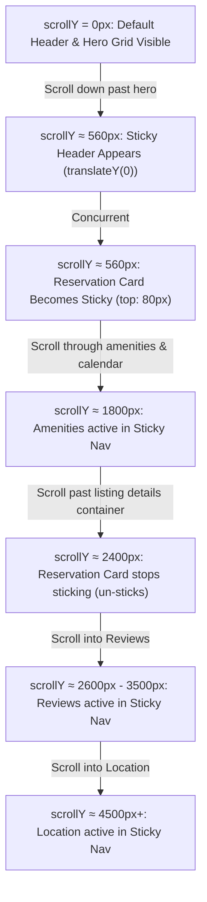

# Airbnb Listing Clone — Reference Specification

## Interaction Matrix

This document provides the exhaustive interaction specification for the desktop-only Airbnb listing page clone, based strictly on rendered visual observation and computed style measurements of the reference application (`https://airbnb-clone-umber-two.vercel.app`) at target viewport **1440px** (with validation at **1280px** and **1920px**).

---

### 1. Interaction Matrix Table

| Element | Trigger | Effect | Duration | Easing | Notes |
| :--- | :--- | :--- | :--- | :--- | :--- |
| **Airbnb Logo** | Hover | Cursor: `pointer`; opacity shifts from `1.0` to `0.85` | 150ms | `ease` | Navigates to home/listing top; retains brand red (`#FF385C`). |
| **Airbnb Logo** | Active (Click) | Scale: `scale(0.96)` momentary compression | 100ms | `ease-out` | Smooth return to top of listing. |
| **Search Bar Pill Container** | Hover | Shadow elevation: `0 1px 2px rgba(0,0,0,0.08)` $\rightarrow$ `0 4px 12px rgba(0,0,0,0.12)`; border stays `#DDDDDD` | 200ms | `ease` | Centered top header element; cursor: `pointer`. |
| **Search Bar Pill Container** | Active (Click) | Border highlight `#222222` or expands search dropdown | 200ms | `ease-in-out` | Triggers search overlay or focuses search fields. |
| **Search Icon Button** (Red Circle) | Hover | Background color: `#FF385C` $\rightarrow$ `#E00B41`; scale `scale(1.04)` | 150ms | `ease` | Contained inside search pill; white search magnifier SVG. |
| **Search Icon Button** | Active (Click) | Scale: `scale(0.94)` | 100ms | `ease-out` | Initiates search query action. |
| **"Become a host" Button** | Hover | Background: `transparent` $\rightarrow$ `#F7F7F7`; border-radius `22px`; cursor: `pointer` | 200ms | `ease` | Text color stays `#222222`; font-size: `14px`, `font-weight: 500`. |
| **Globe (Language) Button** | Hover | Background: `transparent` $\rightarrow$ `#F7F7F7`; border-radius `50%`; cursor: `pointer` | 200ms | `ease` | Circular button containing inline SVG globe. |
| **User Profile Menu Pill** | Hover | Shadow elevation: `0 1px 2px rgba(0,0,0,0.08)` $\rightarrow$ `0 2px 4px rgba(0,0,0,0.18)` | 200ms | `ease` | Pill containing hamburger (3 lines) and user avatar SVG. |
| **User Profile Menu Pill** | Active (Click) | Toggles floating menu popup (Log in, Sign up, Help) | 150ms | `ease` | Closes when clicking outside (backdrop dismiss). |
| **Listing Title Action: "Share"** | Hover | Text underline appears; background: `transparent` $\rightarrow$ `#F7F7F7`; border-radius `8px`; cursor: `pointer` | 150ms | `ease` | Contains share/upload icon + text "Share". |
| **Listing Title Action: "Share"** | Active (Click) | Opens Share modal / copies listing URL to clipboard with confirmation | 200ms | `ease-out` | Focus is trapped inside modal when open. |
| **Listing Title Action: "Saved"** | Hover | Text underline appears; scale `scale(1.04)`; cursor: `pointer` | 150ms | `ease` | Heart icon on left. |
| **Listing Title Action: "Saved"** | Active (Click) | Heart icon fills vibrant red (`#FF385C`); toggles wishlist state between Saved and Unsaved | 200ms | `cubic-bezier(0.175, 0.885, 0.32, 1.275)` | Subtle pop/bounce animation on click. |
| **Promo Banner "Claim" Button** | Hover | Border: `1px solid #222222`; background: `#F7F7F7`; cursor: `pointer` | 150ms | `ease` | Promotional discount tag box on right below hero. |
| **Hero Photo: Main Image (Left)** | Hover | Filter: `brightness(0.92)`; cursor: `pointer` | 300ms | `ease` | Spans full height of 5-image bento grid; rounded left corners (`12px 0 0 12px`). |
| **Hero Photo: Main Image (Left)** | Active (Click) | Opens Photo Tour overlay (`?modal=PHOTO_TOUR_SCROLLABLE`) anchored to photo 0 | 250ms | `ease-out` | Background listing scrolling locked (`overflow: hidden`). |
| **Hero Photos: Secondary (Right 2x2)** | Hover | Filter: `brightness(0.92)`; cursor: `pointer` | 300ms | `ease` | Each individual photo darkens subtly on hover. |
| **Hero Photos: Secondary (Right 2x2)** | Active (Click) | Opens Photo Tour overlay anchored to clicked image category/index | 250ms | `ease-out` | Top-right has `border-radius: 0 12px 0 0`; bottom-right has `border-radius: 0 0 12px 0`. |
| **"Show all photos" Button** | Default | White bg `#FFFFFF`, border `1px solid #222222`, border-radius `8px`, shadow `0 1px 2px rgba(0,0,0,0.08)`, 9-dot grid icon + text | Static | Fixed at bottom-right corner of hero grid (`bottom: 24px; right: 24px;`). |
| **"Show all photos" Button** | Hover | Background: `#F7F7F7`; scale: `scale(1.02)`; shadow: `0 2px 4px rgba(0,0,0,0.15)`; cursor: `pointer` | 200ms | `ease` | Smooth visual lift. |
| **"Show all photos" Button** | Active (Press) | Scale: `scale(0.97)`; background: `#EBEBEB` | 100ms | `ease-out` | Tactile click feedback. |
| **"Show all photos" Button** | Click Action | Opens Photo Tour modal (`?modal=PHOTO_TOUR_SCROLLABLE`) | 250ms | `cubic-bezier(0.2, 0, 0, 1)` | Full viewport slide-up / fade-in transition. |
| **Sticky Navigation Bar** | Scroll Trigger (`scrollY > 560px`) | Appears fixed at top (`position: fixed; top: 0; left: 0; right: 0; z-index: 100;`); background: `#FFFFFF`; border-bottom: `1px solid #EBEBEB` | 250ms | `ease-out` | Slide down (`transform: translateY(0)` from `-100%`) with white background. |
| **Sticky Navigation Bar** | Scroll Trigger (`scrollY <= 560px`) | Retracts above viewport (`transform: translateY(-100%)`) | 200ms | `ease-in` | Hidden when viewing top hero and header. |
| **Sticky Nav Tabs** (`Photos`, `Amenities`, `Reviews`, `Location`) | Hover | Text color: `#717171` $\rightarrow$ `#222222`; cursor: `pointer` | 150ms | `ease` | `font-size: 14px; font-weight: 600; padding: 24px 0;`. |
| **Sticky Nav Tabs: Active Tab** | Scroll / Active State | Underline bar: `border-bottom: 2px solid #222222`; text: `#222222` | 200ms | `ease` | Active state updates automatically based on current intersection observer / scroll position. |
| **Sticky Nav Tabs** | Click | Smooth-scrolls viewport to respective section (`behavior: smooth`) | ~500ms | Browser smooth-scroll | Updates URL anchor or scroll target without layout jump. |
| **Sticky Nav Mini-Reserve Button** | Hover | Background gradient darkens slightly; scale: `scale(1.02)`; cursor: `pointer` | 150ms | `ease` | Displays nightly price + star rating on left, magenta "Reserve" button on right. |
| **Sticky Nav Mini-Reserve Button** | Click | Smooth-scrolls page down to the main reservation card | 400ms | `ease-in-out` | If reservation card is in view, highlights card border. |
| **Sticky Reservation Card** | Scroll Trigger (`scrollY > 560px`) | `position: sticky; top: 80px;` remains pinned in right column | Continuous | GPU-accelerated | Sticks relative to listing main container. |
| **Sticky Reservation Card** | Scroll Boundary (`scrollY >= 2400px`) | Stops sticking; aligns with bottom of listing details container before reviews | Continuous | Native sticky flow | Avoids overlapping reviews and location sections. |
| **Reservation Card: Check-in / Checkout Box** | Hover | Border: `1px solid #222222`; cursor: `pointer` | 150ms | `ease` | Dual-cell box with `CHECK-IN` and `CHECKOUT` labels. |
| **Reservation Card: Check-in / Checkout Box** | Active (Click) | Focus outline `2px solid #222222`; smooth-scrolls or opens calendar picker | 200ms | `ease` | Directs focus to calendar for date selection. |
| **Reservation Card: Guests Selector Box** | Hover | Border: `1px solid #222222`; cursor: `pointer` | 150ms | `ease` | Displays `GUESTS` label, `2 guests`, and chevron icon. |
| **Reservation Card: Guests Selector Box** | Active (Click) | Toggles dropdown stepper panel; chevron rotates 180° (`transform: rotate(180deg)`) | 200ms | `ease` | Floating popover with box-shadow `0 6px 20px rgba(0,0,0,0.15)`. |
| **Guests Dropdown: Stepper Buttons (`-` / `+`)** | Hover | Border color: `#222222`; text: `#222222`; cursor: `pointer` | 150ms | `ease` | Circular button `32px x 32px`, border `1px solid #B0B0B0`. |
| **Guests Dropdown: Stepper Buttons (`-` / `+`)** | Disabled State | Border color: `#EBEBEB`; text: `#EBEBEB`; cursor: `not-allowed` | Instant | Static | Disabled when count reaches minimum (e.g. 1 adult) or max capacity (3 guests). |
| **Reservation Card: Main "Reserve" Button** | Default | Background: `linear-gradient(to right, #E61E4D 0%, #E31C5F 50%, #D70466 100%)`; border: `none`; border-radius: `8px`; color: `#FFFFFF`; font-weight: `600`; font-size: `16px` | Static | Full width of reservation card. |
| **Reservation Card: Main "Reserve" Button** | Hover | Filter: `brightness(1.05)`; shadow: `0 4px 12px rgba(227, 28, 95, 0.35)`; cursor: `pointer` | 200ms | `ease` | Subtle radial sheen or elevation. |
| **Reservation Card: Main "Reserve" Button** | Active (Press) | Scale: `scale(0.98)`; filter: `brightness(0.95)` | 100ms | `ease-out` | Tactile depression feedback. |
| **"Report this listing" Link** | Hover | Text underline; color: `#222222`; cursor: `pointer` | 150ms | `ease` | Centered link below reservation card with small flag SVG. |
| **Description "Show more >"** | Hover | Text underline; cursor: `pointer` | 150ms | `ease` | Bold text `#222222` with chevron right SVG icon. |
| **Description "Show more >"** | Click | Expands full property description block or displays description modal | 250ms | `ease-out` | Toggles truncated text clamp. |
| **"Show all 50 amenities" Button** | Hover | Background: `#F7F7F7`; border-color: `#000000`; cursor: `pointer` | 200ms | `ease` | Pill button: border `1px solid #222222`, border-radius `8px`, padding `13px 23px`. |
| **"Show all 50 amenities" Button** | Active (Click) | Opens full Amenities Modal dialog with categorized amenity list | 250ms | `ease-out` | Modal includes sticky header with close `✕` button. |
| **Inline Calendar: Prev/Next Month Arrows (`<` / `>`)** | Hover | Background: `#F7F7F7`; border-radius `50%`; cursor: `pointer` | 150ms | `ease` | Circular navigation controls flanking month titles. |
| **Inline Calendar: Prev Month Arrow (`<`)** | Disabled State | Opacity: `0.3`; cursor: `not-allowed`; no background change | Instant | Static | Disabled when previous month is earlier than current calendar month. |
| **Inline Calendar: "Clear dates" Button** | Hover | Text color: `#000000`; text-decoration: `underline`; cursor: `pointer` | 150ms | `ease` | Resets check-in and checkout date selections. |
| **Inline Calendar: Date Cell (Available)** | Hover | Border: `1px solid #222222`; border-radius `50%`; cursor: `pointer` | 150ms | `ease` | Clean circle hover outline. |
| **Inline Calendar: Date Cell (Selected Start/End)** | Active Selection | Background: `#222222`; color: `#FFFFFF`; border-radius `50%` | Instant | Static | Solid black circle for check-in and checkout endpoints. |
| **Inline Calendar: Date Cell (In-Range)** | Selected Range | Background: `#F7F7F7`; color: `#222222`; square corners connecting cells | Instant | Static | Continuous grey connecting band between start and end dates. |
| **Inline Calendar: Date Cell (Disabled/Past)** | Disabled State | Text color: `#DDDDDD`; text-decoration: `line-through`; cursor: `not-allowed` | Instant | Static | Unselectable past dates. |
| **Reviews: Category Filter Pills** | Hover | Border: `1px solid #222222`; background: `#F7F7F7`; cursor: `pointer` | 150ms | `ease` | Rounded pill buttons with category icon, label, and count (e.g. `🛋️ Comfort 6`). |
| **Reviews: Category Filter Pills** | Active (Click) | Border: `2px solid #222222`; background: `#F0F0F0` | 150ms | `ease` | Filters reviews list by category. |
| **Reviews: "Show more" on Review Card** | Click | Expands clamped review paragraph to reveal complete text | 200ms | `ease-out` | Smooth height expansion. |
| **Reviews: "Show all 19 reviews" Button** | Hover | Background: `#F7F7F7`; border-color: `#000000`; cursor: `pointer` | 200ms | `ease` | White button with `1px solid #222222`, border-radius `8px`, padding `13px 23px`. |
| **Reviews: "Show all 19 reviews" Button** | Active (Click) | Opens Reviews Modal dialog with search bar, rating breakdown, and full scroll list | 250ms | `ease-out` | Traps focus and locks body scroll. |
| **Meet Your Host: "Contact Host" Button** | Hover | Background: `#F7F7F7`; border-color: `#000000`; cursor: `pointer` | 200ms | `ease` | Rounded pill button. |
| **"More stays nearby" Carousel: Arrows (`<` / `>`)** | Hover | Scale: `scale(1.08)`; shadow: `0 2px 4px rgba(0,0,0,0.18)`; cursor: `pointer` | 150ms | `ease` | Circular button with subtle border and box-shadow. |
| **"More stays nearby" Carousel: Arrows** | Disabled State | Opacity: `0.3`; cursor: `not-allowed`; pointer-events: `none` | Instant | Static | Disabled when at beginning (1/2) or end (2/2) of slider. |
| **"More stays nearby" Stay Card** | Hover | Image scale: `scale(1.03)`; cursor: `pointer` | 300ms | `ease` | Subtle zoom inside rounded image container (`overflow: hidden`). |

---

### 2. Photo Tour Overlay Interactions (View 2)

Triggered via **"Show all photos"** or clicking any image in the Hero Grid.

| Element | Trigger | Effect | Duration | Easing | Notes |
| :--- | :--- | :--- | :--- | :--- | :--- |
| **Photo Tour Modal Backdrop** | Open Trigger | Fullscreen overlay: `background: #FFFFFF`; `z-index: 200`; slides up / fades in | 250ms | `cubic-bezier(0.2, 0, 0, 1)` | Body scroll locked (`overflow: hidden`). |
| **Back Button (`<` or `✕`)** | Hover | Background: `#F7F7F7`; border-radius `50%`; cursor: `pointer` | 150ms | `ease` | Fixed in top header bar of overlay. |
| **Back Button (`<` or `✕`)** | Active (Click) | Closes Photo Tour; restores listing scroll position and URL | 200ms | `ease-in` | Restores window scroll without jump. |
| **Photo Tour Categorized Image Cards** | Hover | Scale: `scale(1.01)`; filter: `brightness(0.95)`; cursor: `pointer` | 200ms | `ease` | Rounded corners (`8px`); high-resolution rendering. |
| **Photo Tour Categorized Image Cards** | Active (Click) | Opens **Lightbox Single-Photo Viewer** (View 3) initialized to that photo index | 200ms | `ease-out` | Updates URL state to include photo item identifier. |
| **Keyboard Escape (`Escape`)** | Keydown | Closes Photo Tour and returns to Listing Page | 200ms | `ease-in` | Standard accessible modal dismiss. |

---

### 3. Lightbox Single-Photo Viewer Interactions (View 3)

Triggered via clicking any photo within the Photo Tour overlay.

| Element | Trigger | Effect | Duration | Easing | Notes |
| :--- | :--- | :--- | :--- | :--- | :--- |
| **Lightbox Backdrop** | Open Trigger | Fullscreen black/white canvas (`#FFFFFF` in reference, or pure contrast mode); `z-index: 300` | 200ms | `ease-out` | Isolates single high-res photo in center of screen. |
| **Close Button (`✕`)** | Hover | Background: `#F7F7F7`; border-radius `50%`; cursor: `pointer` | 150ms | `ease` | Top-right corner of lightbox. |
| **Close Button (`✕`)** | Active (Click) | Closes Lightbox; returns to Photo Tour overlay | 200ms | `ease-in` | Restores Photo Tour scroll position. |
| **Grid View Icon Button (Top-Left)** | Hover | Background: `#F7F7F7`; border-radius `8px`; cursor: `pointer` | 150ms | `ease` | 9-dot grid icon. Returns to Photo Tour. |
| **Previous Photo Button (`<`)** | Hover | Scale: `scale(1.08)`; shadow: `0 4px 12px rgba(0,0,0,0.15)`; cursor: `pointer` | 150ms | `ease` | Circular button on left center of viewport. |
| **Previous Photo Button (`<`)** | Active (Click) | Transitions to previous photo (`index - 1`); updates counter (e.g. `1 of 43`) | 200ms | `ease-in-out` | Smooth cross-fade or slide transition. |
| **Next Photo Button (`>`)** | Hover | Scale: `scale(1.08)`; shadow: `0 4px 12px rgba(0,0,0,0.15)`; cursor: `pointer` | 150ms | `ease` | Circular button on right center of viewport. |
| **Next Photo Button (`>`)** | Active (Click) | Transitions to next photo (`index + 1`); updates counter | 200ms | `ease-in-out` | Smooth cross-fade or slide transition. |
| **Keyboard `ArrowLeft`** | Keydown | Transitions to previous photo (`index - 1`) | 200ms | `ease-in-out` | Accessible keyboard shortcut. |
| **Keyboard `ArrowRight`** | Keydown | Transitions to next photo (`index + 1`) | 200ms | `ease-in-out` | Accessible keyboard shortcut. |
| **Keyboard `Escape`** | Keydown | Closes Lightbox and returns to Photo Tour overlay | 200ms | `ease-in` | Pressing Escape a 2nd time closes Photo Tour to main page. |

---

### 4. Scroll-Triggered Timeline & Offsets Breakdown

- **Sticky Navigation Entry (`scrollY = 560px`)**:
  - The sticky secondary navigation header is hidden by default (`transform: translateY(-100%)`).
  - At `scrollY > 560px` (when the bottom edge of the hero photo grid scrolls out of view), the sticky header transitions into view via `transform: translateY(0)` with a duration of `250ms ease-out`.
  - It remains pinned at the top (`z-index: 100`) across all subsequent scroll positions.
- **Sticky Reservation Card Window (`scrollY = 560px` to `2400px`)**:
  - Positioned statically in the right column until the viewport reaches `scrollY ≈ 560px`.
  - Stays sticky at `top: 80px` alongside the Overview, Highlights, Description, Sleeping Arrangements, Amenities, and Calendar sections.
  - At `scrollY ≈ 2400px` (the boundary between the calendar and the large "Guest favourite" badge preceding the reviews section), the reservation card terminates its sticky tracking and scrolls out with the left column content, ensuring that wide reviews and location sections enjoy full-width layout without visual interference.

---

### 5. Focus Management & Accessibility Standards

1. **Keyboard Focus Rings (`:focus-visible`)**:
   - Outlines use a distinct, high-contrast black ring: `outline: 2px solid #222222; outline-offset: 2px;`.
   - Never suppressed for keyboard users; suppressed for mouse clicks via `:focus:not(:focus-visible)`.
2. **Modal Focus Trap**:
   - When the Photo Tour overlay, Lightbox, or Amenities modal opens:
     - Initial focus is set to the primary close button (`✕` or `<`).
     - Tab navigation cycles exclusively through interactive elements inside the modal.
     - Background document scrolling is frozen using `body { overflow: hidden; }`.
     - Pressing `Escape` reliably dismisses the topmost modal.
3. **ARIA Semantics & Labels**:
   - All icon-only buttons (`Share`, `Saved`, `<` / `>`, `✕`, `Grid`) possess explicit `aria-label` attributes.
   - Sticky navigation tabs utilize `role="tab"` and `aria-selected="true/false"`.
   - Calendar date cells maintain `aria-label="[Date], [Availability Status]"`.
